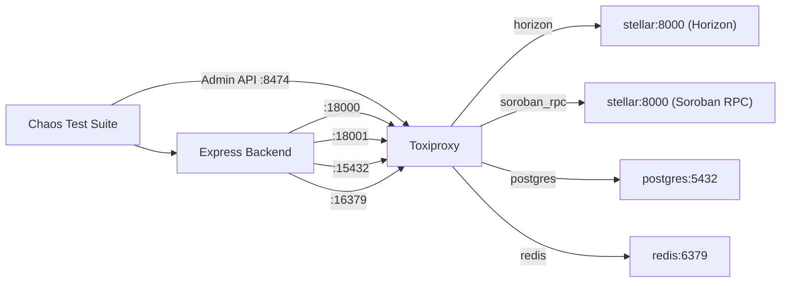

# Chaos Testing: Horizon, Soroban RPC, Postgres, and Redis Failures

**GitHub issue:** [#234](https://github.com/Genghis-codes/Stellar-Global-Wallet/issues/234)  
**Nightly CI workflow:** [`.github/workflows/chaos-nightly.yml`](../../.github/workflows/chaos-nightly.yml)  
**Toxiproxy config:** [`chaos/toxiproxy.json`](../../chaos/toxiproxy.json)  
**Suites:**
- Hermetic real-TCP PR suite (runs in `npm test`): [`backend/tests/chaos/chaosResilience.test.ts`](../tests/chaos/chaosResilience.test.ts)
- Live Docker + Toxiproxy suite (runs nightly & via `npm run test:chaos`): [`backend/tests/chaos/toxiproxyChaos.test.ts`](../tests/chaos/toxiproxyChaos.test.ts)

---

## Why This Matters

Mocked unit tests do not reproduce real socket resets (`ECONNRESET`), TCP blackholes, pooled Postgres connection drops, Redis queue disablement, or Horizon 504 latency races. Injecting real network faults through Shopify's [Toxiproxy](https://github.com/Shopify/toxiproxy) (and a loopback kernel-socket fault proxy on every PR) proves the API degrades predictably and never double-submits user transactions during partial outages.

---

## Compose & Proxy Topology



| Proxy Name | Listen Port | Upstream | Dependency |
|---|---|---|---|
| `horizon` | `18000` | `stellar:8000` | Stellar Horizon |
| `soroban_rpc` | `18001` | `stellar:8000` | Soroban JSON-RPC |
| `postgres` | `15432` | `postgres:5432` | PostgreSQL (idempotency, sessions, pending txs, audit log) |
| `redis` | `16379` | `redis:6379` | Redis (`RedisAccountLock`, sessions, Soroban read cache) |

---

## Scenarios & Explicit Pass Criteria

Every chaos scenario asserts all of the following universal pass criteria via [`chaosAssertions.ts`](../tests/chaos/chaosAssertions.ts):

- **Shared Error Envelope:** Non-2xx responses conform to `{ error: { code, message, retryable? } }` where `code` is registered in `ERROR_CODES` (`backend/src/errors/codes.ts`).
- **Zero Secret / Internal Leakage:** Error payloads never contain stack traces (`at ...`), `postgresql://` or `redis://` URLs, Stellar secret seeds (`S...`), or internal host:port strings.
- **Zero Duplicate Submissions:** Concurrent retries, 504 timeouts, TCP resets, Postgres outages, and Redis outages never cause two transactions to land for one intent.
- **Clean Recovery:** Removing the fault restores healthy behaviour without restarting the Node process.

| Dependency | Fault Injected | Expected Behaviour (Pass Criteria) |
|---|---|---|
| **Horizon** | Network partition (`enabled=false`) | Account/send routes return `502 HORIZON_UNAVAILABLE` (`retryable: true`); `/health` stays `200`; `/api/v1/health/details` returns `503` (`status: "down"`, `checks.horizon.ok: false`); heals cleanly on re-enable. |
| **Horizon** | Mid-stream TCP RST (`reset_peer`) | `POST /api/v1/wallet/submit` returns `502 HORIZON_UNAVAILABLE` (`retryable: true`), releases uncommitted idempotency claim, and succeeds on safe retry with the same `Idempotency-Key`. |
| **Horizon** | Latency spike (`300ms–800ms`) + concurrent retries | Atomic `claimIdempotencyKey` admits strictly **1** upstream submission; concurrent duplicates receive `409 IDEMPOTENCY_KEY_IN_FLIGHT` (`retryable: true`). |
| **Horizon** | Gateway timeout (`504`) | `POST /api/v1/wallet/submit` returns `202 { hash, status: "pending" }` and retains the in-flight idempotency claim so retries do not duplicate. |
| **Soroban RPC** | Partition & TCP RST | `/contract/wallet/spend/build` and `/contract/wallet/submit` return `503 SOROBAN_UNAVAILABLE` (`retryable: true`); `/api/v1/health/details` reports `503 down`. |
| **Soroban RPC** | Slow ledger close (poll deadline) | `/contract/wallet/submit` calls `sendTransaction` strictly **once** and returns `202 { hash, status: "pending" }`. |
| **Postgres** | Partition & TCP RST | Idempotent `/wallet/submit` fails **before** calling Horizon (`horizonSubmitCount === 0`); `/api/v1/health/details` returns `200` (`status: "degraded"`, `checks.postgres.ok: false`). |
| **Postgres** | High latency (`> 1500ms`) | Health check enforces `HEALTH_CHECK_TIMEOUT_MS` and reports `checks.postgres.error: "TimeoutError"` without hanging. |
| **Redis** | Partition (`enabled=false`) | `RedisAccountLock` fails **closed** with `503 LOCK_UNAVAILABLE` (`retryable: true`) — callback never executes unlocked; `/api/v1/health/details` reports `degraded` when `LOCK_BACKEND=redis`. |
| **Redis** | Silent TCP blackhole (`timeout`) | Health check bounds wait and reports `checks.redis.ok: false` within timeout deadline. |

---

## Hardening Findings Fixed While Building Chaos Tests

1. **Atomic idempotency on `POST /api/v1/wallet/submit` (`clientSigning.ts`):** Upgraded from deprecated read-then-write `getCachedResult`/`cacheResult` to atomic `claimIdempotencyKey`/`commitIdempotencyResult`/`releaseIdempotencyKey`, closing a concurrent double-submission race under Horizon latency.
2. **Horizon & Soroban transport error mapping (`stellar.ts`, `soroban.ts`):** Raw `ECONNREFUSED`/`ECONNRESET`/`ETIMEDOUT`/`NetworkError`/502/503 transport errors now translate to retryable `502 HORIZON_UNAVAILABLE` and `503 SOROBAN_UNAVAILABLE` envelopes without leaking internal hosts/ports.
3. **Registered idempotency error codes (`codes.ts`, `packages/i18n/errors/en.json`):** Registered `IDEMPOTENCY_KEY_REUSED` and `IDEMPOTENCY_KEY_IN_FLIGHT` and routed them through `AppError` / `errorHandler`.

---

## Running Locally

```bash
# Fast hermetic real-socket chaos suite (no Docker required)
npx --workspace backend jest tests/chaos/chaosResilience.test.ts

# Full live Toxiproxy + Docker Compose chaos suite
docker compose --profile local --profile chaos up -d postgres redis stellar toxiproxy
npm run test:chaos --workspace backend -- --verbose
docker compose --profile local --profile chaos down -v
```
