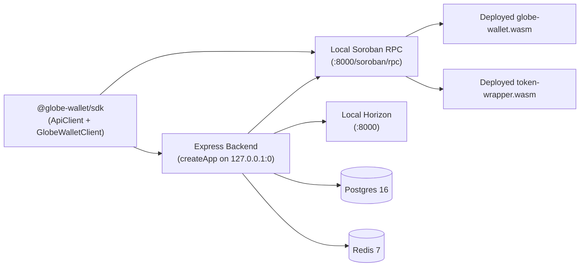

# Hermetic Local Quickstart E2E Suite (Contract + Backend + SDK)

**GitHub issue:** [#232](https://github.com/Genghis-codes/Stellar-Global-Wallet/issues/232)  
**CI workflow:** [`.github/workflows/e2e-local.yml`](../../.github/workflows/e2e-local.yml)  
**Suites:**
- Live quickstart container suite: [`backend/tests/e2e/localQuickstart.test.ts`](../tests/e2e/localQuickstart.test.ts) (`npm run test:e2e:local`)
- Fast loopback PR harness: [`backend/tests/integration/localE2eFlow.test.ts`](../tests/integration/localE2eFlow.test.ts) (runs in standard `npm test`)

---

## Why This Exists

The legacy `e2e-testnet-nightly.yml` suite runs against public Stellar testnet, where Friendbot rate limits, ledger congestion, and quarterly testnet resets cause intermittent flakes. The local quickstart suite replaces that dependency with a hermetic, self-contained `stellar/quickstart:testing` (`--local --enable-soroban-rpc`) container plus Postgres and Redis, deploying freshly compiled `globe-wallet` and `token-wrapper` WASM contracts on every run.

---

## Architecture



---

## Scenarios Covered

1. **SEP-10 Authentication & Cross-Account Guard (SDK ↔ Backend):**
   - `GET /api/v1/auth/challenge` → local Ed25519 sign → `POST /api/v1/auth/token` via `@globe-wallet/sdk` `createClient` + `InMemoryTokenStore`.
   - Asserts cross-account requests return HTTP 403 `ACCOUNT_MISMATCH`.
2. **Non-Custodial Send & Path Payment (SDK ↔ Backend ↔ Local Horizon):**
   - Fresh local Friendbot funding (`http://localhost:8000/friendbot`).
   - `POST /api/v1/wallet/send/precheck` → `POST /api/v1/wallet/send/build` → local signing → `POST /api/v1/wallet/submit` with `Idempotency-Key`.
   - Replays the identical `Idempotency-Key` and confirms identical tx hash + exact single balance delta.
   - `POST /api/v1/wallet/path-payment-strict-send/build` → local sign → submit.
3. **Spend Limits & Timelock (SDK `GlobeWalletClient` + Backend ↔ Local Soroban RPC ↔ Deployed `globe-wallet`):**
   - Initializes `globe-wallet`, registers native XLM via backend build/submit, sets a 50 XLM rolling daily cap on the native XLM SAC (`sacTokenId`).
   - Records a 20 XLM spend (succeeds, remaining = 30 XLM), attempts a 40 XLM spend (rejected in simulation with `SpendLimitExceeded`), verifies a limit increase is timelocked into `pending_spend_limit`, and verifies a limit decrease applies immediately.
4. **Social Recovery Lifecycle (SDK ↔ Backend ↔ Local Soroban RPC ↔ Deployed `globe-wallet`):**
   - Registers 3 guardians (meets `MIN_GUARDIANS_FOR_RECOVERY = 3`), configures 2-of-3 recovery with `MIN_RECOVERY_DELAY_LEDGERS = 17,280`.
   - Guardian 1 initiates recovery → Guardian 2 approves → verifies `quorumReached: true`, `executable: false`.
   - Attempts premature `execute_recovery` (rejected by timelock).
   - Guardian 2 revokes approval → Admin cancels recovery → verifies `proposal: null`.

---

## Running Locally

```bash
# 1. Start local Stellar quickstart, Postgres, and Redis
docker compose --profile local up -d postgres redis stellar

# 2. Build and deploy globe-wallet + token-wrapper to local quickstart
./contract/scripts/deploy-local.sh

# 3. Install & build workspace packages
npm ci && npm run build:packages

# 4. Run the local quickstart E2E suite
npm run test:e2e:local --workspace backend -- --verbose

# 5. Tear down containers when finished
docker compose --profile local down -v
```

---

## Failure Artifacts

Whenever a test fails, [`E2eArtifactRecorder`](../tests/e2e/helpers/e2eArtifacts.ts) writes redacted JSON and Markdown diagnostic timelines to `backend/artifacts/e2e/` (automatically redacting Ed25519 secret seeds `S...`, Bearer JWTs, and sensitive header keys). In CI, `.github/workflows/e2e-local.yml` additionally captures `stellar-quickstart`, `postgres`, and `redis` container logs plus `contract/deployments/local.json` and uploads them as `e2e-local-failure-artifacts` on failure.
