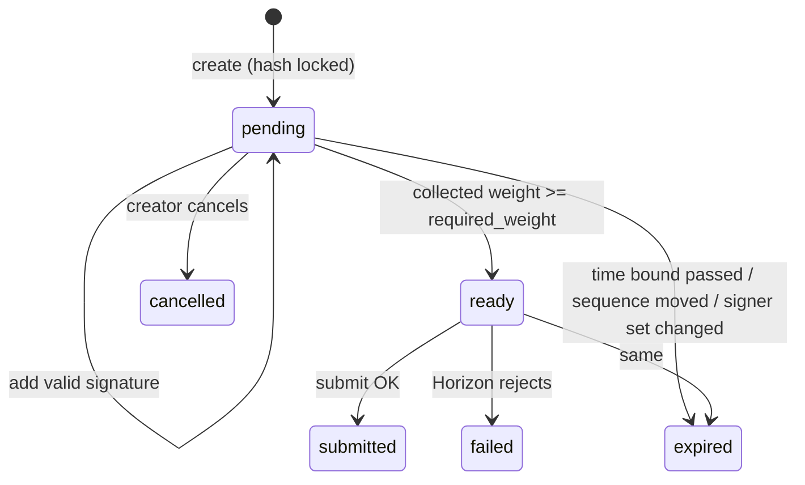

# Pending Multisig Transactions — Co-signing, Validation and Expiry

Tracking issue: #248. Status: **proposed**.

## Current state

- The `pending_txs` table exists ([`src/db.ts`](../src/db.ts)): `account`,
  `xdr`, `required_weight`, `collected_signers` (JSONB), `created_by`,
  `expires_at`, `status`.
- `app.ts` mounts `createPendingTxRouter` at `/api/v1/pending-txs`, but
  `src/routes/pendingTx.ts` (and the `pendingTxs` service) are **not present on
  `main`** — that import needs to be restored or removed before this work
  lands.
- [`StellarService.submitWithAdditionalSignatures`](../src/services/stellar.ts)
  adds signatures from secret keys; nothing checks that the envelope a
  co-signer signs is the one that was created, or that a signature comes from a
  current signer.

## Lifecycle



## Lock the envelope at creation

On `POST /api/v1/pending-txs`:

- Decode the XDR with the configured network passphrase and compute
  `tx.hash()` — the hash of the **transaction body**, which signatures commit
  to. Store it as `tx_hash VARCHAR(64) NOT NULL`.
- Store `source_sequence` (the tx's sequence number) and `max_time` from its
  time bounds. Reject transactions with no `maxTime` (`PENDING_TX_NO_TIMEBOUND`)
  — an open-ended envelope can be submitted long after the co-signers
  agreed to it.
- Snapshot the account's signers and medium/high threshold from Horizon into
  `signer_snapshot JSONB`, and derive `required_weight` from the highest
  threshold any operation in the tx needs (e.g. `setOptions` changing signers
  needs high).

From then on the stored `xdr` is only changed by appending signatures; the
body is never replaced.

## Verify each added signature

`POST /api/v1/pending-txs/:id/signatures` accepts either a decorated signature
(`{ signature, publicKey }`) or a full signed XDR. Clients sign locally; the
API never receives co-signer secret keys.

For each signature:

1. If a full XDR was sent, its body hash must equal `tx_hash`, otherwise
   `PENDING_TX_ENVELOPE_MISMATCH` (409). This is the "altered envelope" check.
2. `publicKey` must be in the **current** signer set (re-fetched from Horizon,
   not only the snapshot) with weight > 0, otherwise `PENDING_TX_NOT_A_SIGNER`
   (403).
3. `Keypair.fromPublicKey(publicKey).verify(txHashBytes, signature)` must be
   true, otherwise `PENDING_TX_BAD_SIGNATURE` (400).
4. A second signature from the same key is a no-op returning 200 with
   `"duplicate": true`; it does not add weight twice.

Steps 2–4 run inside a row lock (`SELECT … FOR UPDATE`) so two co-signers
adding at once can't overwrite each other's entry in `collected_signers`.

`collected_signers` entries become `{ publicKey, weight, signedAt }`; collected
weight is the sum of weights from the current signer set.

## Expiry

A pending tx moves to `expired` when any of these hold:

| Trigger | Check |
|---|---|
| Time bound passed | `NOW() > max_time` |
| Sequence moved | Account's current sequence ≥ `source_sequence` (another tx used it) |
| Signer set changed | Current signers/thresholds differ from `signer_snapshot` in a way that changes any collected weight or the required threshold |

Checks run lazily on every read/sign/submit of that row, plus a sweep job every
minute over the `pending_txs_expires_at_idx` index. Expired rows are kept for
30 days for audit, then deleted. Signing an expired tx returns
`PENDING_TX_EXPIRED` (410).

## Notifying signers

When a pending tx is created, and again on each signature, notify every signer
in the snapshot who hasn't signed yet using the existing push
([`pushSender.ts`](../src/services/pushSender.ts)) and email
([`emailNotifier.ts`](../src/services/emailNotifier.ts)) channels. Notifications
carry the pending-tx id, account, a short operation summary and the expiry
time — never the XDR. When the tx reaches `ready`, `submitted`, `failed` or
`expired`, notify the creator and all signers once.

## Error codes

| Code | Status | When |
|---|---|---|
| `PENDING_TX_NO_TIMEBOUND` | 400 | Created without `maxTime`. |
| `PENDING_TX_BAD_SIGNATURE` | 400 | Signature doesn't verify against `tx_hash`. |
| `PENDING_TX_NOT_A_SIGNER` | 403 | Key isn't a current signer with weight > 0. |
| `PENDING_TX_ENVELOPE_MISMATCH` | 409 | Submitted XDR body differs from the locked one. |
| `PENDING_TX_EXPIRED` | 410 | Any expiry trigger above. |
| `PENDING_TX_NOT_READY` | 409 | Submit called before weight is met. |

## Schema changes

```sql
ALTER TABLE pending_txs
  ADD COLUMN tx_hash VARCHAR(64) NOT NULL,
  ADD COLUMN source_sequence BIGINT NOT NULL,
  ADD COLUMN signer_snapshot JSONB NOT NULL;
CREATE UNIQUE INDEX pending_txs_tx_hash_idx ON pending_txs (tx_hash);
```

The unique index stops the same transaction being opened twice.

## Test plan

- **Signature for an altered envelope is rejected**: create from XDR A, sign
  XDR B (same source, different amount) and submit it → 409
  `PENDING_TX_ENVELOPE_MISMATCH`; a bare signature over B's hash → 400
  `PENDING_TX_BAD_SIGNATURE`.
- Signature from a key not on the account → 403.
- Signer removed from the account after creation → their new signature is
  rejected and the tx is re-evaluated/expired.
- Duplicate signature doesn't double-count weight.
- Concurrent signatures from two signers both persist.
- `maxTime` in the past, and account sequence bumped → `PENDING_TX_EXPIRED`.
- Notifications sent to unsigned signers only; payloads contain no XDR.
