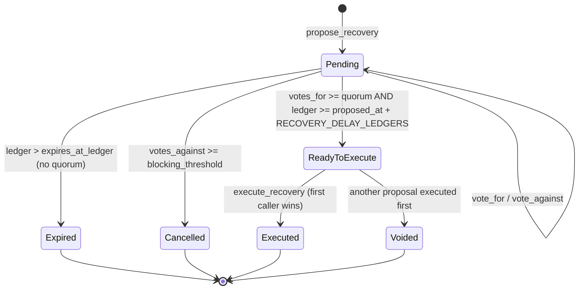

# Recovery Proposals: Expiry and Competing Proposals

**GitHub issue:** [#243](https://github.com/Genghis-codes/Stellar-Global-Wallet/issues/243)

## Problem

The contract enforces `RecoveryAlreadyPending`: only one recovery proposal may
exist at a time. A malicious or coerced guardian can create a proposal pointing
to an address they control, and—because proposals never expire—block every
honest attempt permanently. If the admin key is simultaneously lost there is no
way out: the account is deadlocked.

## Threat Model

| Scenario | Current behaviour | Fixed behaviour |
|---|---|---|
| Single guardian creates rogue proposal | Blocks all others indefinitely | Proposal expires after N ledgers without quorum |
| Admin key lost + rogue proposal active | No recovery possible | Honest proposal can compete; first to quorum + delay wins |
| Guardian votes for wrong address by mistake | Proposal stuck open | Guardian can retract / vote against; honest competing proposal can proceed |
| Two honest proposals race | Second rejected | Both live; first to reach quorum + delay is applied |

## Design

### Proposal expiry

Each proposal stores `proposed_at_ledger` and `expires_at_ledger`
(`proposed_at_ledger + PROPOSAL_TTL_LEDGERS`). `PROPOSAL_TTL_LEDGERS` defaults
to 17 280 (≈ 24 hours at ~5 s/ledger) and is a configurable contract constant.

A proposal that has not reached quorum by `expires_at_ledger` is considered
void. Any guardian may then start a fresh proposal for any target address.

### Competing proposals

The uniqueness constraint on pending proposals is lifted. Each proposal is
identified by `(proposer, proposed_address)` so the same proposer cannot open
two proposals for the same target, but different guardians can propose different
targets simultaneously.

Execution order: the first proposal to satisfy both quorum and the
`RECOVERY_DELAY_LEDGERS` waiting period can call `execute_recovery`. Others are
automatically voided once execution succeeds.

### Vote against

Guardians can call `vote_against_recovery(proposer, proposed_address)` to
register opposition. A vote-against cancels that guardian's existing vote-for on
the same proposal, if any. A proposal where `votes_against ≥ blocking_threshold`
(configurable, default: `quorum`) is immediately cancelled and cannot be
re-submitted by the same proposer for `PROPOSAL_COOLDOWN_LEDGERS`.

### Storage model

```
RecoveryProposal {
  proposed_address: Address,
  votes_for:        Vec<Address>,
  votes_against:    Vec<Address>,
  proposed_at_ledger: u32,
  expires_at_ledger:  u32,
}

// keyed by (proposer: Address)
RecoveryProposals(owner)  →  Map<Address, RecoveryProposal>
```

### Events

| Event | Fields |
|---|---|
| `recovery_proposed` | `owner`, `proposer`, `proposed_address`, `expires_at_ledger` |
| `recovery_vote_for` | `owner`, `proposer`, `proposed_address`, `voter` |
| `recovery_vote_against` | `owner`, `proposer`, `proposed_address`, `voter` |
| `recovery_proposal_expired` | `owner`, `proposer`, `proposed_address` |
| `recovery_proposal_cancelled` | `owner`, `proposer`, `proposed_address`, `reason` |
| `recovery_executed` | `owner`, `new_address`, `proposer` |

### State machine



## Tasks

- [ ] Remove the `RecoveryAlreadyPending` uniqueness guard; key proposals by `(owner, proposer)`
- [ ] Add `expires_at_ledger` to `RecoveryProposal` and enforce expiry in all proposal reads
- [ ] Implement `vote_against_recovery`; apply `blocking_threshold` cancellation logic
- [ ] Update `execute_recovery` to void all other proposals on success
- [ ] Emit all events listed above
- [ ] Add `PROPOSAL_TTL_LEDGERS` and `PROPOSAL_COOLDOWN_LEDGERS` as configurable constants
- [ ] Update OpenAPI spec and SDK for any new or changed endpoints
- [ ] Update this doc and README once live
- [ ] Add tests (see test plan below)

## Test Plan

1. **Rogue proposal expires:** one guardian opens a proposal; no other guardian
   votes for it; advance ledger past `expires_at_ledger`; confirm a second
   guardian can now open a fresh proposal without error.
2. **Honest proposal succeeds after rogue:** rogue proposal is open; honest
   guardians form quorum on a competing proposal; confirm `execute_recovery`
   succeeds and voids the rogue proposal.
3. **Vote against cancels:** enough guardians vote against a proposal; confirm
   the proposal is cancelled and the proposer cannot resubmit during cooldown.
4. **Vote against removes vote for:** a guardian who previously voted for a
   proposal calls `vote_against_recovery`; confirm their vote-for is retracted
   and the for-count decrements.
5. **Race to execute:** two honest proposals both reach quorum; confirm exactly
   one succeeds and the other is voided (not an error).
6. **Admin-lost scenario:** no admin key available; rogue proposal expires;
   honest guardians recover without admin involvement.
7. **Negative: expired proposal cannot execute:** confirm `execute_recovery`
   fails with an appropriate error when called on an expired proposal.

## Acceptance Criteria

- No single guardian can deadlock recovery indefinitely.
- A rogue proposal expires after `PROPOSAL_TTL_LEDGERS` and allows fresh proposals.
- Guardians can vote against; a proposal cancelled by opposition cannot be
  re-submitted by the same proposer during the cooldown.
- Competing proposals are allowed; the first to quorum + delay executes.
- All events are emitted on every state transition.
- CI is green (lint, type-check, tests).
- No new TODOs without a linked issue.

## References

- Contract: [`contract/contracts/globe-wallet/src/lib.rs`](../contract/contracts/globe-wallet/src/lib.rs)
- [Soroban auth and multi-sig patterns](https://developers.stellar.org/docs/build/smart-contracts/example-contracts/auth)
