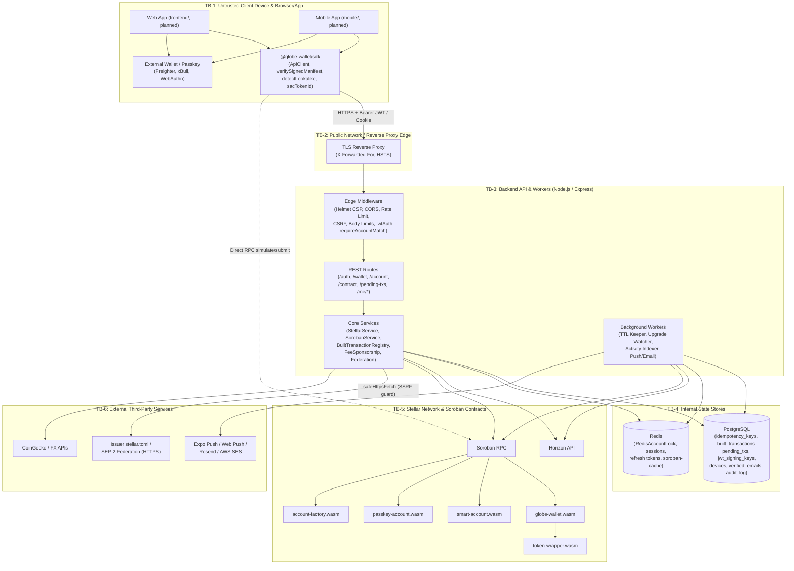
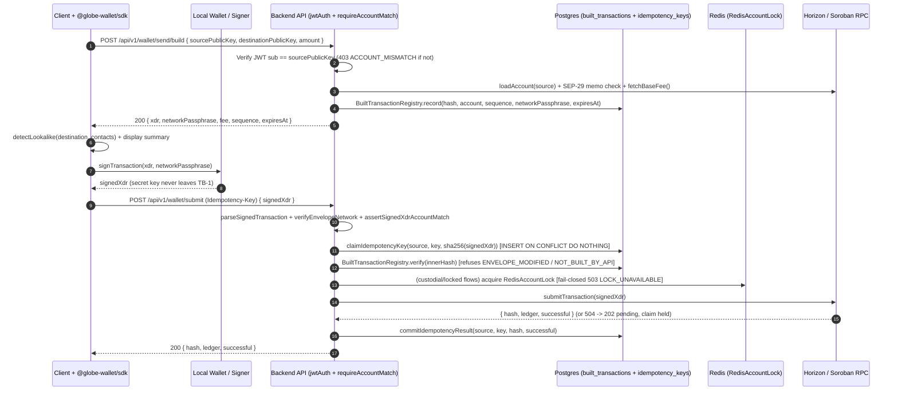
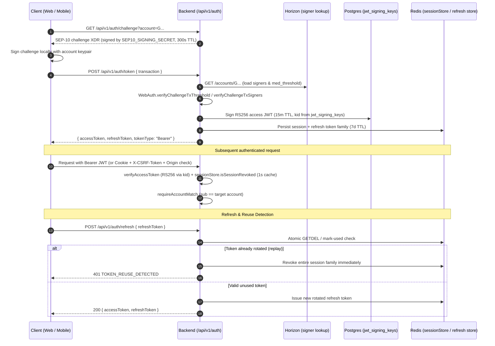
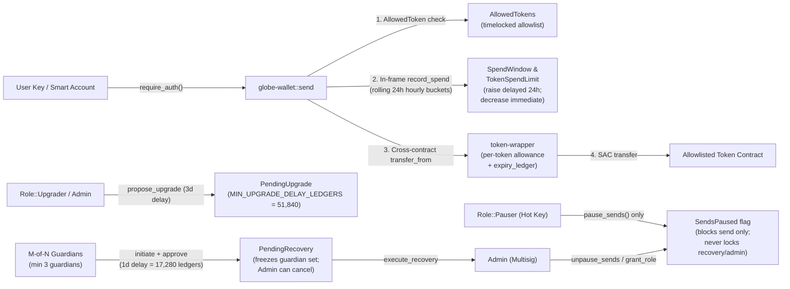

# Stellar Global Wallet — System-Wide Threat Model

**GitHub issue:** [#238](https://github.com/Genghis-codes/Stellar-Global-Wallet/issues/238)  
**Scope:** End-to-end security model covering Soroban smart contracts (`contract/`), Backend REST API & workers (`backend/`), TypeScript SDK & shared packages (`packages/`), and client applications (`frontend/`, `mobile/`, external wallets).  
**Status:** Ready for two-maintainer security review (prerequisite for external audit and mainnet launch — see [`docs/mainnet-launch-checklist.md`](mainnet-launch-checklist.md)).

---

## 1. System Inventory, Assets & Trust Boundaries

### 1.1 Crown-Jewel Assets to Protect

| Asset | Location | Confidentiality | Integrity | Availability | Impact if Compromised |
|---|---|:---:|:---:|:---:|---|
| **User funds (XLM & issued SAC tokens)** | Stellar ledger & Soroban token contracts | Public | Critical | High | Direct irreversible financial loss |
| **User signing keys (Ed25519 / Passkey P-256 / Session keys)** | Client device / wallet / secure enclave (and transiently in memory on legacy custodial routes) | Critical | Critical | High | Unauthorized transfers up to daily/session caps (or unlimited on plain `G...` accounts) |
| **Contract governance keys (`Admin`, `Upgrader`, `AllowlistManager`, `Pauser`, `AccountFactory.Admin`)** | Hardware / multisig signers | Critical | Critical | High | Malicious contract upgrade (post-timelock), malicious token allowlisting, or forced send pause |
| **Recovery guardian keys (`GuardianSet`)** | Independent guardian holders | High | Critical | High | Colluding M-of-N guardians can hijack `Admin` / smart-account signers after timelock |
| **Backend signing & operational keys (`jwt_signing_keys` RS256, `SEP10_SIGNING_SECRET`, `API_KEY`, `FEE_SPONSOR_SECRET_KEY`, `TTL_KEEPER_SECRET_KEY`)** | Backend env / secrets manager / Postgres | Critical | Critical | Medium | Forged sessions, cross-account API abuse, fee-sponsor wallet drain |
| **Offline manifest release signing key** | Offline release workstation / HSM | Critical | Critical | Low | Ability to sign poisoned contract IDs / Horizon URLs accepted by pinned SDK clients |
| **User operational metadata (verified email, push tokens, preferences, pending multisig XDRs, idempotency records)** | PostgreSQL & Redis | Medium | High | Medium | Privacy disclosure, notification spoofing, duplicate submissions |

### 1.2 Explicit Security Assumptions

1. **Stellar Consensus Protocol (SCP), Horizon, and Soroban Host invariants hold:** Transaction finality, Ed25519/secp256r1 host verification (`env.crypto()`), Soroban `ContractReentryMode::Prohibited` (CAP-0046-11), and atomic rollback on contract error are assumed sound.
2. **Transport security:** Production deployments terminate TLS 1.2+ at a reverse proxy with `TRUST_PROXY_HOPS` accurately matching the real hop count (`backend/src/config.ts`).
3. **Admin multisig on mainnet:** Before mainnet launch (#239), `globe-wallet` `Admin` and `account-factory` `Admin` are Stellar multisig accounts, not single hot keys.
4. **Non-custodial target architecture:** Legacy `*SecretKey` routes (`backend/docs/security-model.md`) are deprecated (sunset 2027-01-01) and excluded from new client flows; all new integrations use build → local sign → submit (`backend/docs/client-signing.md`).

### 1.3 System Architecture & Trust Boundaries (DFD-1)

### 1.4 Non-Custodial Transaction Build → Sign → Submit Flow (DFD-2)

### 1.5 Authentication & Session Lifecycle (DFD-3)

### 1.6 On-Chain Governance, Spend Limits & Social Recovery Flow (DFD-4)

---

## 2. STRIDE Analysis per Component

### 2.1 Smart Contracts (`contract/contracts/*`)

Covers `globe-wallet`, `token-wrapper`, `smart-account`, `passkey-account`, and `account-factory`. Extends the narrower proofs in [`contract/docs/record-spend-reentrancy.md`](../contract/docs/record-spend-reentrancy.md), [`contract/docs/design/wiring-reentrancy-threat-model.md`](../contract/docs/design/wiring-reentrancy-threat-model.md), and [`contract/docs/design/smart-accounts.md`](../contract/docs/design/smart-accounts.md).

| ID | STRIDE | Threat Scenario | Code Pointer | Severity | Status & Mitigations | Linked Issues |
|---|---|---|---|---|---|---|
| **T-CON-01** | **S**poofing | Attacker invokes `record_spend`, `add_asset`, `set_spend_limit`, or `send` impersonating another user, or front-runs `account-factory` / `passkey-account::init`. | `contract/contracts/globe-wallet/src/lib.rs`, `contract/contracts/account-factory/src/lib.rs`, `contract/contracts/passkey-account/src/lib.rs` | Critical | **Mitigated.** Every state-mutating entrypoint invokes `require_auth()` before storage reads; `account-factory::create_account` is admin-gated and atomically deploys + calls `SmartAccount::init` in one transaction so init cannot be front-run; `passkey-account` verifies WebAuthn `client_data_json` challenge = `base64url(signature_payload)`, UP/UV flags, and strictly increasing sign counter. | `#180`, `#181` |
| **T-CON-02** | **T**ampering | Reentrancy or malicious `token_id` callback corrupts `SpendWindow` / `DailySpent` or performs fake settlement during `globe-wallet::send` → `token-wrapper::transfer_from` → `token::transfer`. | `contract/contracts/globe-wallet/src/lib.rs`, `contract/contracts/token-wrapper/src/lib.rs` | Critical | **Mitigated.** Checks-Effects-Interactions ordering commits `record_spend` in-frame before calling `token-wrapper`; Soroban host enforces `ContractReentryMode::Prohibited`; `send` enforces an admin-curated, timelocked `AllowedToken` allowlist rejecting arbitrary token contracts (`WalletError::TokenNotAllowed`), tested with an adversarial mock token contract (`test_send_rejects_reentrant_malicious_token`). | `#92`, `#189` |
| **T-CON-03** | **T**ampering | Attacker splits spends across UTC midnight to spend 2× the daily limit, or spends freely before setting a limit to evade caps. | `contract/contracts/globe-wallet/src/lib.rs` | High | **Mitigated.** Rolling 24h hourly-bucket window (`SpendWindow`) eliminates the midnight reset boundary; spends are always recorded even when `limit == 0` so activating a cap retroactively accounts for recent spends; limit increases are timelocked for 24h (`SPEND_LIMIT_INCREASE_DELAY_SECS`), whereas decreases take effect immediately. | `#176`, `#177`, `#179` |
| **T-CON-04** | **T**ampering | User holds a plain `G...` classic account rather than a Soroban `smart-account`, allowing a stolen key to transfer funds directly on Horizon or via `token-wrapper::transfer_from`, bypassing `globe-wallet` caps. | `contract/contracts/globe-wallet/src/lib.rs`, `contract/contracts/smart-account/src/lib.rs` | High | **Partially Mitigated / Architectural Boundary.** `globe-wallet` limits are advisory for plain `G...` accounts because classic accounts do not invoke `globe-wallet::__check_auth`. True on-chain enforcement requires migrating users to per-user `smart-account` contracts (enforcing caps inside `__check_auth`). Documented in `contract/docs/design/architecture.md` and `smart-accounts.md`. | `#180`, `#182` |
| **T-CON-05** | **T**ampering | Cross-token allowance confusion in `token-wrapper` (an approval for a worthless token used to drain USDC). | `contract/contracts/token-wrapper/src/lib.rs` | High | **Mitigated.** Allowances are keyed strictly by `(owner, spender, token_id)` (`WrapperDataKey::TokenAllowance`); legacy unscoped `(owner, spender)` entries are ignored; underlying SAC `transfer` still requires `from`'s auth tree. | `#174` |
| **T-CON-06** | **E**levation of Privilege | Compromised admin instantly replaces contract WASM, swaps guardian set during an active recovery, or drains TVL via a single key. | `contract/contracts/globe-wallet/src/lib.rs` | Critical | **Mitigated (Contract) / Pre-Mainnet Ops Required.** Upgrades require `MIN_UPGRADE_DELAY_LEDGERS` (3 days / 51,840 ledgers); guardian changes are timelocked once recovery is configured and frozen while any recovery proposal is pending; fine-grained roles (`Role::Upgrader`, `Role::AllowlistManager`, `Role::Pauser`) separate duties; `Pauser` can only pause `send` and cannot unpause. Global value-at-risk caps and mandatory admin multisig remain pre-mainnet gates. | `#84`, `#175`, `#190`, `#191`, `#239`, `#240` |
| **T-CON-07** | **E**levation of Privilege | Compromised or colluding guardians take over `Admin` (or `smart-account` signers), or admin adds an attacker/typo address as guardian without guardian consent. | `contract/contracts/globe-wallet/src/lib.rs`, `contract/contracts/smart-account/src/lib.rs` | High | **Partially Mitigated.** Requires `MIN_GUARDIANS_FOR_RECOVERY = 3`, `threshold >= 2`, and `MIN_RECOVERY_DELAY_LEDGERS` (24h) during which the legitimate admin/owner can `cancel_recovery`. Two-step guardian consent (`invite_guardian` + `accept_guardian_invitation`) and guardian liveness heartbeats are designed and tracked. | `#175`, `#241`, `#242` |
| **T-CON-08** | **E**levation of Privilege | Stolen `smart-account` or `passkey-account` session key escalates privileges by calling `add_signer`, `upgrade`, or unapproved token contracts. | `contract/contracts/smart-account/src/lib.rs`, `contract/contracts/passkey-account/src/lib.rs` | High | **Mitigated.** Session signatures must be sole signatures (`SessionMixedSignatures`), cannot target the account contract itself (`SessionScopeViolation` / `AdminRequired`), enforce `allowed_contracts`, `allowed_fns`, per-token lifetime `token_caps` (default-deny for unlisted tokens), and max 30-day expiry. | `#181`, `#182` |
| **T-CON-09** | **D**enial of Service | Persistent storage entry archival causes a user's `SpendLimit` to silently disappear and read as `0` (unlimited), or archives active allowances before `expiry_ledger`. | `contract/contracts/globe-wallet/src/lib.rs`, `contract/contracts/token-wrapper/src/lib.rs`, `backend/src/services/ttlKeeper.ts` | High | **Mitigated.** `DataKey::LimitOptIn(user, token)` records opt-in so an archived limit fails closed instead of reading as unlimited; `token-wrapper::approve` extends persistent TTL to at least `expiry_ledger`; permissionless `extend_user_ttl` / `extend_allowance_ttl` + backend `ttlKeeper` keep entries live; storage layout v2 moves guardians/proposals out of instance storage to cap `send` footprint. | `#184`, `#185` |
| **T-CON-10** | **R**epudiation | Privileged or user contract mutations occur without an observable audit trail for indexers and alerting. | `contract/contracts/globe-wallet/src/lib.rs`, `contract/docs/events.md` | Medium | **Mitigated.** Every state-mutating entrypoint emits a versioned event `(name, EVENT_VERSION = 1)` consumed by `upgradeWatcher`, `recoveryNotifier`, and `activityFeed`. | `#186`, `#192` |
| **T-CON-11** | **T**ampering (Supply Chain) | Compromised Rust crate or silently modified vendored `ed25519-dalek` enters contract WASM binary. | `contract/Cargo.toml`, `contract/deny.toml`, `contract/scripts/verify-vendored-ed25519.sh`, `contract/scripts/wasm-size.sh` | High | **Mitigated.** `contract.yml` runs `verify-vendored-ed25519.sh` (diff vs crates.io), `cargo-deny`, `cargo-audit`, and `wasm-size.sh` (fails if `ed25519-dalek` is ever linked into WASM — on-chain verification uses host crypto). Reproducible WASM build verification tracked in `docs/reproducible-contract-builds.md`. | `#183`, `#236`, `#239` |
| **T-CON-12** | **T**ampering / Drift | Schema mismatch between backend `globeWallet.ts` (`assetCode: String`) and updated workspace `globe-wallet` contract (`token_id: Address` SAC IDs). | `backend/src/services/contracts/globeWallet.ts`, `contract/contracts/globe-wallet/src/lib.rs` | Medium | **Open / Tracked.** Workspace contract & `@globe-wallet/sdk` migrated spend limits to SAC `token_id: Address` (#173), while backend `globeWallet.ts` retains `String` encoding for compatibility with the older live testnet deployment. Must align backend contract client before deploying updated WASM to testnet/mainnet. | `#173`, `#232` |

---

### 2.2 Backend API & Workers (`backend/src/*`)

| ID | STRIDE | Threat Scenario | Code Pointer | Severity | Status & Mitigations | Linked Issues |
|---|---|---|---|---|---|---|
| **T-API-01** | **E**levation of Privilege (IDOR) | Authenticated user B (`sub = BOB`) calls an endpoint targeting user A's account (`export.csv`, `sponsor-fee`, `admin/accept`, `wallet/submit`, `contract/wallet/submit`, `:publicKey/thresholds`, `:publicKey/muxed`, legacy `*SecretKey`, `me/email/verify`, `transactions/account/:id/statuses`). | `backend/src/middleware/requireAccountMatch.ts`, `backend/src/routes/*.ts`, `backend/tests/security/authzMatrix.test.ts` | Critical | **Mitigated (#233).** All 9 discovered IDOR gaps closed in #233 (`requireAccountMatch` expanded to `innerAccount`, `candidate`, secret-key derivation, `:publicKey` params, signed-XDR source verification, `verifyToken` account check, `sponsorFeeBump` inner-source check). Exhaustive CI authz matrix fails build on any unclassified route. | `#33`, `#233` |
| **T-API-02** | **S**poofing | Attacker replays a stolen refresh token, uses a revoked session JWT, submits a raw `x-api-key` to protected routes, or brute-forces `POST /api/v1/auth/login`. | `backend/src/middleware/jwtAuth.ts`, `backend/src/services/sessionStore.ts`, `backend/src/utils/jwt.ts`, `backend/src/routes/auth.ts` | High | **Mitigated.** RS256 asymmetric JWTs with JWKS rotation (#199); per-request revocation check (`sessionStore.isSessionRevoked`, ≤ 1s propagation); atomic refresh rotation (`GETDEL`) & replay detection revoking the entire session family (`TOKEN_REUSE_DETECTED`); `apiKeyAuth` removed (#40); dedicated login rate limit (10 req / 15 min) + constant-time `timingSafeEqual` on `API_KEY`. | `#40`, `#91`, `#199`, `#200` |
| **T-API-03** | **S**poofing / **E**oP | Legacy shared `API_KEY` grants unscoped `sub: "api-key-user"` access across all accounts and cannot be rotated without downtime. | `backend/src/middleware/loginApiKey.ts`, `backend/src/middleware/requireAccountMatch.ts`, `backend/docs/api-keys.md` | High | **Partially Mitigated / Tracked.** Restricted to `POST /auth/login` and `POST /admin/rotate-jwt-keys`; rejected on `pending-txs` (signer check). Per-client HMAC-hashed scoped API keys with overlap rotation designed in `backend/docs/api-keys.md`. | `#88`, `#251` |
| **T-API-04** | **T**ampering | Attacker modifies an unsigned XDR returned by `/build` (e.g., changes recipient, injects operations, swaps network passphrase) and submits it to `/wallet/submit` to abuse API rate limits or fee sponsorship. | `backend/src/services/builtTransactions.ts`, `backend/src/services/transactionEnvelope.ts`, `backend/src/utils/networkCheck.ts` | High | **Mitigated.** `BuiltTransactionRegistry` records every built hash + network + expiry and rejects modified or third-party envelopes (`ENVELOPE_MODIFIED`, `NOT_BUILT_BY_API`); `verifyEnvelopeNetwork` checks signer hints against configured passphrase (`WRONG_NETWORK`); startup `assertNetworkConfigurationMatches()` halts boot on Horizon/RPC mismatch. | `#194`, `#223` |
| **T-API-05** | **I**nformation Disclosure | User secret keys sent to deprecated custodial routes persist in V8 heap memory, crash core dumps, or accidentally enter access logs/telemetry. | `backend/src/routes/wallet.ts`, `backend/src/routes/contract.ts`, `backend/docs/security-model.md`, `backend/tests/middleware/morgan-body-logging.test.ts` | Critical | **Partially Mitigated.** Morgan `"combined"` format tested to never log bodies; `rejectUnknownBodyFields` blocks secret keys on all modern `/build` and `/submit` routes without echoing them; legacy routes emit `Deprecation`/`Sunset: 2027-01-01` headers. Full elimination requires removing legacy routes at sunset. | `#1`, `#2`, `#4`, `#105` |
| **T-API-06** | **T**ampering / Double-Spend | Concurrent requests, Horizon 504 timeouts, or Redis/Postgres outages cause duplicate transaction submissions or sequence races (`tx_bad_seq`). | `backend/src/services/idempotency.ts`, `backend/src/routes/clientSigning.ts`, `backend/src/services/locks/redisAccountLock.ts` | High | **Mitigated (#197, #198, #234).** Atomic `INSERT ... ON CONFLICT DO NOTHING` idempotency claims with SHA-256 body fingerprinting across both `/wallet/send` and `/wallet/submit`; 504 timeouts retain in-flight claim and return `202 pending`; `RedisAccountLock` uses Lua token-checked leases + fencing tokens and **fails closed** (`503 LOCK_UNAVAILABLE`) if Redis is unreachable. Verified by chaos suite. | `#3`, `#197`, `#198`, `#234` |
| **T-API-07** | **S**poofing / **I**nfo Disclosure (SSRF) | Attacker passes internal IP / loopback / cloud metadata host (`169.254.169.254`, `127.0.0.1`, DNS rebinding) to SEP-2 federation (`/api/v1/resolve`) or `stellar.toml` lookup (`/api/v1/assets/*`). | `backend/src/services/safeHttpsFetch.ts`, `backend/src/services/federation.ts`, `backend/src/routes/assets.ts` | High | **Mitigated.** `safeHttpsFetch` enforces HTTPS-only, public DNS hostnames, blocks loopback/private/link-local/metadata IPv4 & IPv6 ranges after DNS resolution, bounds response bytes and timeouts, and strictly validates SEP-2 addresses and memos (`docs/federation-security.md`). | `#63`, `#201` |
| **T-API-08** | **D**enial of Service | Attacker exhausts backend CPU/memory/DB/sponsor funds via huge JSON payloads, X-Forwarded-For spoofing, fee-sponsorship farming, CSP log flooding, or slow dependency hangs. | `backend/src/app.ts`, `backend/src/routes/cspReport.ts`, `backend/src/services/feeSponsorship.ts`, `backend/src/db.ts` | Medium | **Mitigated.** Strict `10kb` global JSON body limit (`64kb` only on XDR routes); fixed `TRUST_PROXY_HOPS` (never boolean `true`); global + `/auth/login` + `/csp-report` rate limiters; per-account daily fee-sponsorship stroop budget, XLM eligibility ceiling (`< 1 XLM`), and max 10 ops/tx; health check deadline (`1500ms`) + 10s cache; graceful shutdown draining (#220). | `#90`, `#91`, `#195`, `#220`, `#252` |
| **T-API-09** | **I**nformation Disclosure | Stack traces, internal host:port errors, SQL errors, or secrets leak in HTTP 5xx error responses during Horizon/RPC/Postgres/Redis outages. | `backend/src/middleware/errorHandler.ts`, `backend/src/services/stellar.ts`, `backend/src/services/soroban.ts` | Medium | **Mitigated (#22, #234).** Centralized `errorHandler` maps errors to `{ error: { code, message, details?, retryable?, requestId?, traceId? } }` without stack traces; Horizon & Soroban transport errors translate to retryable `502 HORIZON_UNAVAILABLE` / `503 SOROBAN_UNAVAILABLE`. Verified by `chaosResilience.test.ts`. | `#22`, `#234` |
| **T-API-10** | **T**ampering (CSRF) | Malicious website triggers state-changing API requests using ambient browser session cookies. | `backend/src/app.ts` | High | **Mitigated.** Double-submit `gw_csrf` cookie (`SameSite=Strict`) compared via `crypto.timingSafeEqual` against `X-CSRF-Token` header, plus `Origin` header allowlist verification (`CORS_ORIGIN`, never wildcard `*` with `credentials: true`). | `#34`, `#35`, `#41` |
| **T-API-11** | **E**levation of Privilege | Testnet-only Friendbot route (`/api/v1/dev/fund`) or interactive Swagger UI (`/api/docs`) exposed accidentally in production/mainnet. | `backend/src/app.ts`, `backend/src/routes/dev.ts`, `backend/src/config.ts` | Medium | **Mitigated.** `/api/v1/dev` only mounts when `STELLAR_NETWORK === "testnet"`; `/api/docs` and `/api/openapi.json` default to disabled (`404`) when `NODE_ENV === "production"` unless explicitly enabled via `ENABLE_API_DOCS=true`. | `#16`, `#69`, `#253` |
| **T-API-12** | **T**ampering / Lockout | Malicious or buggy `setOptions` transaction lowers signer weights below thresholds, permanently locking out the user's Stellar account. | `backend/src/services/setOptions.ts`, `backend/src/routes/wallet.ts` | High | **Mitigated.** `simulateSetOptions` simulates resulting signer weights vs low/med/high thresholds and rejects lockouts with `422 SET_OPTIONS_LOCKOUT`. | `#72`, `#249` |
| **T-API-13** | **R**epudiation | Sensitive operational actions (keypair generation, admin JWT rotation, account mutations) lack tamper-evident logging or request correlation. | `backend/src/services/auditLog.ts`, `backend/src/telemetry/middleware.ts`, `backend/src/app.ts` | Medium | **Mitigated.** Hash-chained `audit_log` + `keypair_audit_log` (hashing caller identity, never raw secrets); sanitized inbound `X-Request-Id` (`^[A-Za-z0-9-]{8,64}$`, preventing log injection); OpenTelemetry `traceId` propagation. | `#23`, `#43`, `#88`, `#221` |
| **T-API-14** | **I**nformation Disclosure | RS256 JWT private keys stored in plaintext PEM inside `jwt_signing_keys` table in Postgres; database read compromise exposes active signing keys. | `backend/src/utils/jwtKeys.ts`, `backend/docs/preferences.md` | High | **Partially Mitigated / Tracked.** Keys never leave Postgres/backend to external verifiers (who use `/.well-known/jwks.json`), and rotation retires old keys cleanly, but encrypting `private_key_pem` at rest with a KMS/envelope key is recommended before mainnet launch. | `#199`, `#239`, `#250` |

---

### 2.3 SDK & Shared Packages (`packages/sdk`, `packages/bindings/*`, `packages/types`, `packages/i18n`)

| ID | STRIDE | Threat Scenario | Code Pointer | Severity | Status & Mitigations | Linked Issues |
|---|---|---|---|---|---|---|
| **T-SDK-01** | **T**ampering | Compromised backend or MITM serves a tampered `/api/v1/config` pointing clients at an attacker-controlled contract ID or malicious Horizon/RPC URL. | `packages/sdk/src/security/manifest.ts`, `packages/sdk/tests/manifest.test.ts` | Critical | **Mitigated.** `verifySignedManifest` verifies Ed25519 signatures over recursive `canonicalJson(manifest)` against pinned offline release public keys (supporting key rotation with multiple pinned keys) and rejects unsigned/unpinned/modified manifests (`ManifestVerificationError`). | `#226` |
| **T-SDK-02** | **S**poofing (Address Poisoning) | Attacker sends dust transactions from a vanity address sharing leading/trailing characters with a user's frequent contact so the user copy-pastes the attacker's address. | `packages/sdk/src/security/lookalike.ts`, `backend/src/services/paymentFlags.ts` | High | **Mitigated.** `detectLookalike` / `precheckDestination` flags lookalike destinations against contacts and recent counterparties; backend flags `dust`, `memo_url`, and `unknown_asset` on incoming payments; curated verified-asset badge list prevents fake asset spoofing. | `#54`, `#104`, `#105` |
| **T-SDK-03** | **T**ampering (Precision Loss) | JavaScript IEEE-754 floating-point rounding corrupts 7-decimal Stellar amounts or `i128` stroop values (`> 2^53`). | `packages/sdk/src/validate/`, `packages/sdk/src/format/`, `backend/src/utils/stroops.ts`, `docs/amount-handling.md` | High | **Mitigated.** Amounts are strictly validated decimal strings (`<= 7` decimal places) converted via `BigInt` stroops; JSON numbers rejected at API boundary. | `#102`, `#103` |
| **T-SDK-04** | **D**enial of Service / Duplicate Spend | `ApiClient` automatically retries a timed-out `POST` without an `Idempotency-Key`, or concurrent 401s trigger parallel refresh-token exchanges causing false reuse-detection revocation. | `packages/sdk/src/client.ts`, `packages/sdk/tests/client.test.ts` | High | **Mitigated.** `ApiClient` never retries non-idempotent `POST` unless `idempotencyKey` is explicitly provided; single-flight `refreshPromise` coalesces concurrent `TOKEN_EXPIRED` 401s into exactly one `/api/v1/auth/refresh` call; only `TOKEN_EXPIRED` triggers refresh. | `#18`, `#200` |
| **T-SDK-05** | **T**ampering (Supply Chain) | Compromised npm publish credentials or malicious PR injects backdoored code into `@globe-wallet/sdk` or transitive dependencies. | `.github/workflows/pr-malware-guard.yml`, `.github/workflows/pr-security.yml`, `.github/workflows/pr-package-signatures.yml`, `docs/specs/supply-chain-hardening.md` | Critical | **Partially Mitigated / Tracked.** PRs are automatically scanned with ClamAV + `pr_malware_guard.py`, `dependency-review-action`, `lockfile-lint` (HTTPS + npm host + integrity hash), and `npm audit signatures`. Full npm `--provenance`, Syft SBOMs, cosign image signing, and SHA-pinned Actions are tracked in `#236`. | `#236` |
| **T-SDK-06** | **T**ampering (Interface Drift) | Hand-edited contract bindings diverge from deployed `globe-wallet` WASM, causing silent argument mis-encoding. | `.github/workflows/contract-bindings.yml`, `contract/scripts/bindings.sh` | Medium | **Mitigated.** CI rebuilds WASM, regenerates `packages/bindings/globe-wallet`, and fails if generated files are stale. | `#75`, `#76` |

---

### 2.4 Clients (`frontend/` Web App, `mobile/` React Native App, External Wallets)

Although `frontend/` and `mobile/` UI code has not yet been implemented, their security contract is defined in [`backend/docs/auth.md`](../backend/docs/auth.md), [`backend/docs/client-signing.md`](../backend/docs/client-signing.md), [`backend/docs/security/csp.md`](../backend/docs/security/csp.md), and [`docs/specs/analytics.md`](specs/analytics.md).

| ID | STRIDE | Threat Scenario | Code / Spec Pointer | Severity | Status & Mitigations | Linked Issues |
|---|---|---|---|---|---|---|
| **T-CLI-01** | **I**nformation Disclosure (XSS) | Cross-site scripting on the web app steals tokens from `localStorage` or injects malicious scripts. | `backend/docs/auth.md`, `backend/docs/security/csp.md`, `backend/src/app.ts` | Critical | **Mitigated (Design + API Edge).** Web auth uses `HttpOnly`, `Secure`, `SameSite` cookies (never `localStorage`); strict CSP + violation reporting (`/csp-report`); API sets `default-src 'none'; frame-ancestors 'none'` and `Cross-Origin-Resource-Policy: same-site`. | `#34`, `#35`, `#119`, `#252` |
| **T-CLI-02** | **I**nformation Disclosure (Mobile Storage) | Mobile app writes refresh tokens or seed material to unencrypted `AsyncStorage`, device backups, screenshots, or crash/analytics logs. | `backend/docs/auth.md`, `docs/specs/analytics.md` | High | **Mitigated (Spec).** Access tokens held strictly in memory; refresh tokens stored exclusively in `expo-secure-store` (iOS Keychain / Android Keystore); analytics privacy spec bans PII, addresses, and key material from telemetry. | `#34`, `#235` |
| **T-CLI-03** | **T**ampering (Blind Signing / UI Redressing) | Compromised API or phishing page tricks user into signing an XDR whose destination, asset, fee, or operation differs from what the UI displayed. | `backend/docs/client-signing.md`, `docs/federation-security.md`, `packages/sdk/src/security/lookalike.ts` | Critical | **Mitigated (Protocol + SDK).** Clients must decode and display the actual XDR operations, resolved federation `accountId`, `reserveDelta`, `spendableXlmAfter`, `networkPassphrase`, and lookalike warnings before invoking Freighter/xBull/Passkey signing; `frame-ancestors 'none'` blocks clickjacking. | `#63`, `#64`, `#104` |
| **T-CLI-04** | **S**poofing (Phishing / Fake SEP-7 Links) | Attacker crafts a malicious `web+stellar:pay?...` deep link with a lookalike destination, wrong asset issuer, or oversized memo. | `backend/src/routes/wallet.ts`, `packages/sdk/src/validate/` | Medium | **Mitigated.** `POST /wallet/payment-requests/parse` validates address checksums, decimal precision, issuer presence, and 28-byte UTF-8 memo limit, emitting explicit warnings; clients must require explicit confirmation and run `detectLookalike` before signing. | `#103`, `#104` |
| **T-CLI-05** | **S**poofing (WebAuthn Origin / Relay) | Phishing site relays a WebAuthn passkey assertion to sign an unintended Soroban auth entry. | `contract/contracts/passkey-account/src/lib.rs` | High | **Mitigated.** WebAuthn binds assertions to RP ID (`origin`) in the browser/OS authenticator; `passkey-account::__check_auth` binds `client_data_json.challenge` to the exact Soroban auth payload (which includes nonce + expiration ledger) and requires `User Verified` (biometric/PIN) for all `Admin` passkeys. | `#181` |
| **T-CLI-06** | **I**nformation Disclosure (Clipboard / Side-Channel) | Malicious browser extension or mobile keyboard reads copied secret seed or alters pasted Stellar address. | `backend/docs/client-signing.md`, `packages/sdk/src/security/lookalike.ts` | Medium | **Mitigated (Guidance).** Non-custodial hardware/passkey/extension signers eliminate raw seed copy-paste; `detectLookalike` catches clipboard-hijacker address swaps before signing. | `#104`, `#181` |

---

## 3. Key-Compromise Scenarios & Incident Response Playbooks

This section analyzes the four principal key-compromise domains required before audit sign-off: **User**, **Admin**, **Guardian**, and **Backend**.

### 3.1 User Key Compromise

| Key Variant | Blast Radius | Built-In Containment | Recovery Playbook | Residual Risk |
|---|---|---|---|---|
| **Plain `G...` Ed25519 master key** | Full control over all classic Stellar balances & trustlines on the account; can sign SEP-10 challenges for API sessions. | None on-chain for direct Horizon transfers (`globe-wallet` caps are advisory for plain `G...` accounts — see `T-CON-04`). | 1. Immediately sweep remaining funds to a new keypair. 2. Call `POST /api/v1/auth/sessions/revoke-all` (or revoke refresh tokens) to terminate attacker sessions. 3. Migrate user to a `smart-account` (`#180`). | Complete loss of funds on classic `G...` account if attacker moves faster than user. |
| **`smart-account` root Ed25519 signer** | Can sign token transfers **up to the configured daily spend cap per token**. Cannot raise caps immediately (24h `LIMIT_INCREASE_DELAY`). Cannot upgrade contract to unapproved WASM (requires `account-factory.is_wasm_approved`). | Per-token daily cap enforced inside `__check_auth`; cap increases timelocked 24h; guardian recovery replaces all signers & revokes all session keys. | 1. User (if threshold allows) or guardians initiate social recovery (`initiate_recovery` → M-of-N approvals → 24h timelock → `execute_recovery`). 2. `execute_recovery` atomically replaces all signers with the fresh key and revokes all session keys. 3. Optionally lower caps to `1` stroop immediately if user still holds key. | Attacker can drain up to 1× daily cap per 24h until recovery completes (~24h = max 2× daily cap). |
| **Scoped Session Key (`smart-account` / `passkey-account`)** | Restricted strictly to `allowed_contracts`, `allowed_fns`, listed `token_caps` (lifetime cap), and `expires_at <= 30d`. Cannot touch account admin/signers or unlisted tokens. | Lifetime token cap + account daily cap + contract/function allowlist + hard expiry. | 1. Root/admin signer calls `revoke_session_key(pk)` immediately (no timelock). 2. Revoke associated backend API sessions. | Loss strictly bounded to remaining unused `SessionKey.token_caps`. |
| **Passkey (WebAuthn P-256)** | Bound to hardware secure enclave + biometric/PIN (`UV` flag required for `Admin`). Requires physical device unlock or compromised authenticator backup. | Hardware-bound key + strictly increasing authenticator sign counter detects cloned keys (`CounterNotIncreased`). | 1. Use a second registered `Admin` passkey (or guardian recovery) to call `remove_signer(compromised_id)`. | Minimal unless attacker possesses unlocked device + biometric/PIN. |

---

### 3.2 Contract Admin & Privileged Role Key Compromise

| Key Variant | Blast Radius | Built-In Containment | Recovery Playbook | Residual Risk |
|---|---|---|---|---|
| **`globe-wallet` `Admin` (single key or compromised multisig quorum)** | Can propose contract upgrades (`propose_upgrade`), propose token allowlist additions (`propose_allowed_token`), queue guardian changes, pause/unpause sends, and grant/revoke roles. **Cannot** unilaterally move user funds on `smart-account` or classic `G...` accounts without user auth. | **3-day upgrade timelock** (`MIN_UPGRADE_DELAY_LEDGERS = 51,840`); **timelocked token allowlisting** (#189); **timelocked guardian changes** (#175, frozen while recovery is active); public `upgradeWatcher` & ops webhooks alert immediately (`GET /api/v1/contract/upgrade/status`). | 1. Ops receives `upgrade_proposed` / `admin_proposed` alert from `upgradeWatcher`. 2. If non-compromised `Pauser` exists, invoke `pause_sends` (`RB-01` in `docs/mainnet-launch-checklist.md`) to halt `globe-wallet::send`. 3. Honest M-of-N guardians immediately run `initiate_recovery` + `approve_recovery` (1-day timelock < 3-day upgrade timelock!) to replace `Admin` before any malicious upgrade can execute. 4. New `Admin` cancels any malicious pending upgrade/allowlist/role grants and rotates `Pauser`/`Upgrader`/`AllowlistManager`. | Attacker could disrupt availability (pause sends) or cancel honest recovery if they retain `Admin` before guardian coordination; **mainnet requires Admin to be an M-of-N multisig** so a single key leak cannot act. |
| **`Role::Pauser` (hot incident key)** | Can **only** call `pause_sends`. Cannot unpause, upgrade, modify allowlists, or touch guardians. | Strictly least-privilege (`Role::Pauser`); never locks out admin rotation, recovery, or upgrades. | 1. `Admin` multisig calls `set_pauser(admin, None)` / `revoke_role(Pauser)` and `unpause_sends(admin)`. | Temporary DoS on `globe-wallet::send` until `Admin` unpauses. |
| **`Role::Upgrader` / `Role::AllowlistManager`** | Can propose (not bypass timelock on) WASM upgrades or token allowlist entries. | 3-day upgrade timelock + allowlist timelock + `upgradeWatcher` public alerts. | 1. `Admin` multisig revokes role via `revoke_role` and cancels pending proposal (`cancel_allowed_token` / supersede upgrade). | Zero fund loss if cancelled within the timelock window. |
| **`account-factory` `Admin`** | Can deploy deterministic `smart-account` addresses for uncreated `user_id`s and approve/revoke upgrade WASMs (`approve_wasm`). Cannot force existing `smart-account` instances to upgrade without each user's own `__check_auth`. | Per-account upgrade requires BOTH user auth AND `factory.is_wasm_approved(hash)`. | 1. Rotate `account-factory` admin multisig signers. 2. Call `revoke_wasm` for any malicious hash. 3. Audit `account_created` events for squatted unissued `user_id`s. | Risk of address squatting for future users until revoked; zero direct theft from existing accounts. |

---

### 3.3 Guardian Key Compromise

| Scenario | Blast Radius | Built-In Containment | Recovery Playbook | Residual Risk |
|---|---|---|---|---|
| **1 Guardian key compromised (`1 < M`)** | Can call `initiate_recovery(g, attacker)` or approve an existing proposal, causing alert noise and freezing guardian-set changes while proposal is pending. **Cannot** reach quorum (`threshold >= 2`). | Requires M-of-N (`M >= 2`, `N >= 3`); emits `recovery_initiated` event triggering `recoveryNotifier` push + email alerts to owner and all other guardians. | 1. Admin / owner immediately calls `cancel_recovery`. 2. Admin queues `remove_guardian(compromised)` (and adds replacement once timelock clears). | Temporary nuisance/griefing only; zero account takeover risk. |
| **Minority compromised (`< M`)** | Same as single guardian — cannot reach quorum or arm the timelock. | Quorum invariant `approvals.len() >= threshold`. | 1. Cancel any rogue proposal. 2. Rotate compromised guardians via `remove_guardian` / `add_guardian`. | Griefing only. |
| **Quorum compromised (`>= M` colluding guardians)** | Can initiate and approve a recovery to an attacker-controlled `new_admin` / `new_signer` and arm the timelock. | **24-hour mandatory timelock** (`MIN_RECOVERY_DELAY_LEDGERS = 17,280` / `delay_seconds >= 86,400`); immediate push + email alerts via `recoveryNotifier` & `emailNotifier`. | 1. Legitimate Admin / owner calls `cancel_recovery` within the 24h timelock window. 2. On `globe-wallet`: pause sends (`RB-01`), rotate guardian set immediately. 3. On `smart-account`: sweep funds to a fresh account with a new guardian set. 4. Revoke all backend sessions (`revokeAllSessions`). | **Critical if owner is offline > 24h and misses all alerts.** Mitigated operationally by geographically/organizationally independent guardians and multi-channel alerting (push + email + on-chain watcher). |
| **Guardians lost / permanently stale (`available < M`)** | No theft risk, but social recovery becomes unusable if the owner also loses their signing key. | Tracked in `#242` (guardian heartbeat liveness checks & stale guardian replacement). | 1. While Admin/owner still holds key, replace unreachable guardians before an emergency occurs. | Permanent lockout if BOTH owner key AND `< M` guardians are lost simultaneously. |

---

### 3.4 Backend & Operational Key Compromise

| Secret / Key | Blast Radius | Built-In Containment | Recovery Playbook | Residual Risk |
|---|---|---|---|---|
| **JWT RS256 signing key (`jwt_signing_keys` in Postgres)** | Attacker can mint valid Bearer access tokens (`sub = any G...`) and call API endpoints (read private CSV/email/devices, build unsigned XDRs, spam fee sponsorship). **Cannot** sign Stellar or Soroban transactions for non-custodial users (keys never touch backend). | Short 15m access token TTL; `BuiltTransactionRegistry` + user local signing prevents unauthorized fund movement on non-custodial flows; fee sponsorship capped per account/day. | 1. Call `POST /api/v1/admin/rotate-jwt-keys` **twice** (immediately evicting both `current` and `previous` keys from `jwt_signing_keys` and JWKS). 2. Flush active sessions in Redis (`revokeAllSessions`). 3. Rotate Postgres credentials and audit `audit_log`. | Access to off-chain user metadata (emails, preferences, devices, CSV exports) during compromise window; **critical** if legacy custodial routes still receive user secret keys in transit! |
| **`SEP10_SIGNING_SECRET`** | Attacker can forge SEP-10 challenge transactions appearing to originate from `HOME_DOMAIN`. | Challenges have sequence 0 (invalid as real ledger transactions) and 300s TTL; cannot move user funds. | 1. Rotate `SEP10_SIGNING_SECRET` in secrets manager & update `stellar.toml` `SIGNING_KEY`. 2. Restart backend instances. | Phishing risk for users who blindly sign challenges if attacker MITMs `/auth/token`. |
| **Shared `API_KEY`** | Attacker can exchange key at `POST /auth/login` for unscoped `sub: "api-key-user"` JWT and call `POST /api/v1/admin/rotate-jwt-keys`. | Cannot sign non-custodial user transactions; rejected on `pending-txs` signer checks; login rate-limited. | 1. Rotate `API_KEY` immediately in secrets manager and redeploy. 2. Revoke all `api-key-user` sessions in Redis. 3. Complete migration to scoped hashed API keys (`#251`). | Cross-account API access on non-signer-scoped routes until rotated. |
| **`FEE_SPONSOR_SECRET_KEY`** | Attacker can drain XLM held in the sponsor hot wallet. Cannot touch user funds. | Separate dedicated hot account funded only with minimal operational XLM; policy engine caps per-account daily stroops & max 10 ops/tx. | 1. Sweep remaining XLM from sponsor account to cold treasury. 2. Unset/rotate `FEE_SPONSOR_SECRET_KEY` (endpoint fails cleanly with `503 FEE_SPONSOR_NOT_CONFIGURED`). | Loss strictly bounded to XLM balance of sponsor hot wallet. |
| **`TTL_KEEPER_SECRET_KEY`** | Attacker can drain XLM held in the keeper fee-payer hot wallet. Holds zero contract authority (`extend_user_ttl` is permissionless). | Minimal operational XLM balance only; zero privileged contract roles. | 1. Sweep remaining XLM and replace `TTL_KEEPER_SECRET_KEY`. | Bounded to small XLM fee float. |
| **PostgreSQL / Redis credentials** | Full read/write to `jwt_signing_keys`, `idempotency_keys`, `built_transactions`, `pending_txs`, `devices`, `verified_emails`, Redis sessions, and `RedisAccountLock`. | Network isolation (private VPC); non-custodial user keys never stored in DB or Redis; signed manifests verified against offline pinned keys. | 1. Rotate DB & Redis credentials. 2. Rotate JWT keys twice + flush Redis sessions. 3. Inspect `built_transactions` and `audit_log` hash chain for tampering. | Session hijacking (via `jwt_signing_keys`), metadata exposure, or lock disruption until rotated; cannot steal non-custodial user funds directly. |
| **Offline Manifest Release Key (`#226`)** | Attacker could sign a malicious deployment manifest pointing clients to a rogue contract ID or Horizon URL. | Held offline (never on backend or CI runners); clients pin explicit public keys and support multi-key rotation. | 1. Ship emergency SDK/client release removing compromised public key from `trustedPublicKeys` and pinning replacement key. 2. Re-sign canonical manifests with new key. | High impact if undetected; keep key strictly air-gapped / HSM-backed. |
| **Full Backend RCE / Host Compromise** | Attacker gains all backend env secrets, DB/Redis access, AND can intercept plaintext `sourceSecretKey` sent to deprecated legacy routes. | Non-custodial clients sign locally and verify signed manifests against offline pinned keys; Soroban contracts enforce spend caps and allowlists on-chain. | 1. Isolate compromised instances; pause sends (`RB-01`) if needed. 2. Rotate ALL backend secrets above. 3. Notify any users who recently invoked deprecated custodial endpoints to sweep funds immediately. | **Zero direct fund theft for non-custodial users verifying XDR before signing**; full exposure for legacy custodial route callers (reinforcing sunset urgency). |

---

## 4. Security Verification & Continuous Testing Matrix

| Security Domain | Automated Verification Suite | Cadence | Issue |
|---|---|---|---|
| **Route Authorization & IDOR Prevention** | `backend/tests/security/authzMatrix.test.ts` (CI fails on any unclassified route; tests every route × `{anon, otherAccount, ownAccount, apiKeyHeader, apiKeyJwt}`) | Every PR (`backend.yml`) | `#233` |
| **Security Headers & CSP** | `backend/tests/security/helmetHeaders.test.ts`, `backend/src/__tests__/cspReport.test.ts`, `backend/src/__tests__/bodyLimit.test.ts` | Every PR (`backend.yml`) | `#119`, `#252` |
| **Secret-Key Logging & Validation** | `backend/tests/middleware/morgan-body-logging.test.ts`, `backend/tests/routes/secretKeyValidation.test.ts` | Every PR (`backend.yml`) | `#1`, `#4`, `#105` |
| **SSRF & Federation Validation** | `backend/src/__tests__/safeHttpsFetch.test.ts`, `backend/src/__tests__/federationSecurity.test.ts` | Every PR (`backend.yml`) | `#63`, `#201` |
| **Multi-Network & Intent Integrity** | `backend/src/__tests__/networkSafety.test.ts`, `backend/tests/routes/wallet.submitIntent.test.ts` | Every PR (`backend.yml`) | `#194`, `#223` |
| **SDK Manifest Pinning & Lookalikes** | `packages/sdk/tests/manifest.test.ts`, `packages/sdk/tests/lookalike.test.ts`, `packages/sdk/tests/client.test.ts` | Every PR (`packages.yml`) | `#18`, `#104`, `#226` |
| **Contract Reentrancy, Auth & Supply Chain** | `cargo test --workspace`, `verify-vendored-ed25519.sh`, `cargo-deny`, `cargo-audit`, `wasm-size.sh` | Every PR (`contract.yml`) | `#92`, `#183` |
| **Hermetic Contract + Backend + SDK E2E** | `backend/tests/e2e/localQuickstart.test.ts` + `backend/tests/integration/localE2eFlow.test.ts` | Every PR (`e2e-local.yml` & `backend.yml`) | `#232` |
| **Failure & Outage Resilience (Chaos)** | `backend/tests/chaos/chaosResilience.test.ts` (PR) + `backend/tests/chaos/toxiproxyChaos.test.ts` (Nightly Toxiproxy) | Every PR + Nightly (`chaos-nightly.yml`) | `#234` |
| **PR Dependency & Malware Scanning** | `.github/workflows/pr-malware-guard.yml`, `pr-security.yml`, `pr-package-signatures.yml`, `codeql.yml` | Every PR | `#236` |
| **Threat Model Documentation Integrity** | `backend/tests/security/threatModelDocs.test.ts` (verifies all STRIDE sections, key-compromise playbooks, and cited repo paths exist) | Every PR (`backend.yml`) | `#238` |

---

## 5. Open Security Priorities Before Mainnet Audit

1. **Sunset & remove legacy custodial `*SecretKey` endpoints** (`T-API-05`) prior to mainnet deployment (`docs/mainnet-launch-checklist.md`).
2. **Align backend `globeWallet.ts` spend-limit routes to SAC `token_id: Address`** (`T-CON-12`, `#173`) to match the current workspace contract and SDK bindings.
3. **Implement global value-at-risk daily caps** (`#240`, `docs/global-value-at-risk-caps.md`).
4. **Ship two-step guardian consent & guardian liveness heartbeats** (`#241`, `#242`).
5. **Encrypt `jwt_signing_keys.private_key_pem` at rest** (`T-API-14`) and migrate `API_KEY` to scoped HMAC-hashed keys (`#251`).
6. **Complete CI/CD supply-chain hardening** — Syft SBOMs, cosign image signing, npm `--provenance`, SHA-pinned GitHub Actions (`#236`).

---

## 6. Maintainer Review & Sign-Off (#238 Test Plan)

Per `#238`'s test plan, this system threat model must be reviewed and signed off by **two maintainers** before external audit kickoff:

| Reviewer | Role | Areas Verified | Status | Date |
|---|---|---|---|---|
| Maintainer 1 (`@TBD`) | Contract & Governance Lead | Section 2.1 (Contracts STRIDE), Section 3.1–3.3 (User/Admin/Guardian compromise), DFD-4 | Pending review | — |
| Maintainer 2 (`@TBD`) | Backend, SDK & Infra Lead | Sections 2.2–2.4 (Backend/SDK/Clients STRIDE), Section 3.4 (Backend compromise), DFD-1–3 | Pending review | — |

---

## 7. Related Documents

- [`contract/docs/record-spend-reentrancy.md`](../contract/docs/record-spend-reentrancy.md)
- [`contract/docs/design/wiring-reentrancy-threat-model.md`](../contract/docs/design/wiring-reentrancy-threat-model.md)
- [`contract/docs/design/architecture.md`](../contract/docs/design/architecture.md)
- [`contract/docs/design/smart-accounts.md`](../contract/docs/design/smart-accounts.md)
- [`backend/docs/security-model.md`](../backend/docs/security-model.md)
- [`backend/docs/security/authz-matrix.md`](../backend/docs/security/authz-matrix.md)
- [`backend/docs/e2e-local-testing.md`](../backend/docs/e2e-local-testing.md)
- [`backend/docs/chaos-testing.md`](../backend/docs/chaos-testing.md)
- [`docs/network-safety.md`](network-safety.md)
- [`docs/session-store.md`](session-store.md)
- [`docs/federation-security.md`](federation-security.md)
- [`docs/global-value-at-risk-caps.md`](global-value-at-risk-caps.md)
- [`docs/mainnet-launch-checklist.md`](mainnet-launch-checklist.md)
- [`docs/specs/supply-chain-hardening.md`](specs/supply-chain-hardening.md)
